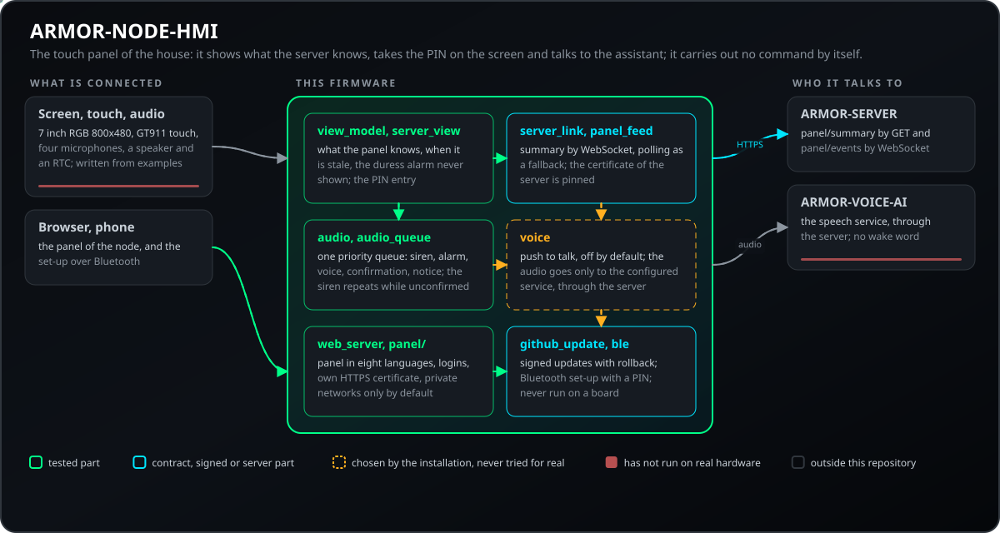
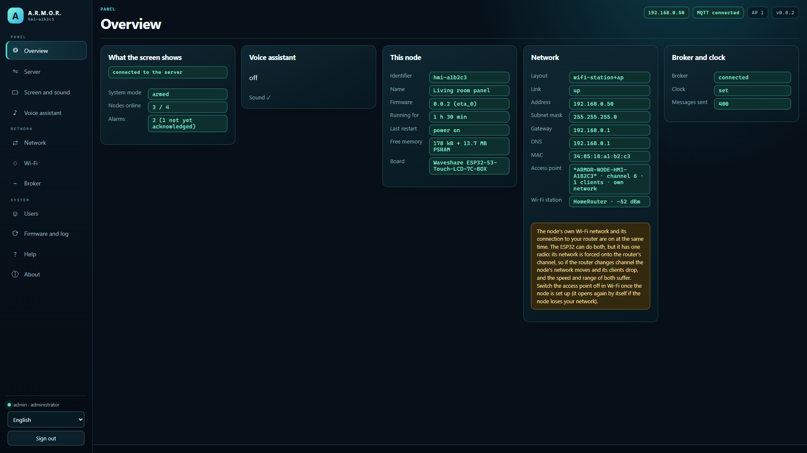
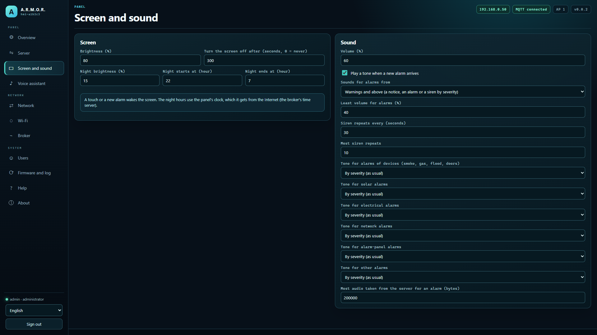
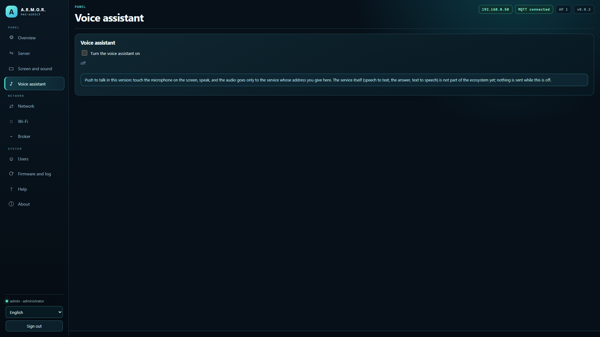
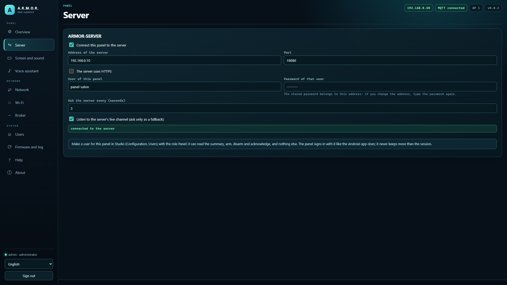
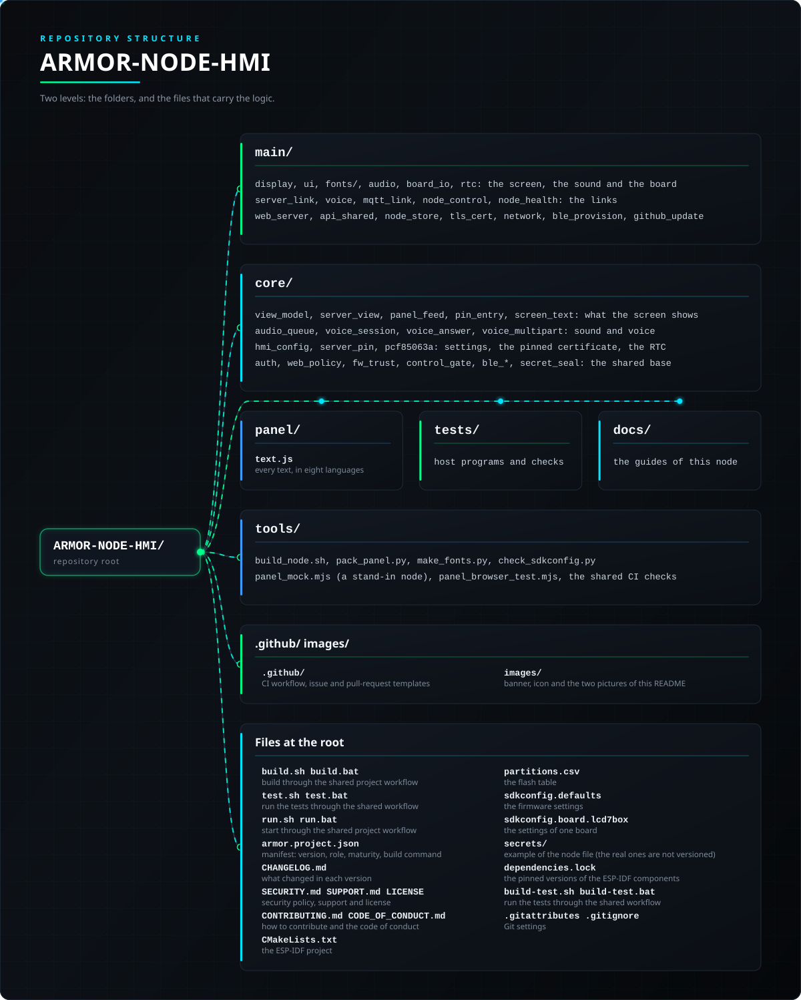

<p align="center">
  
</p>

# 🖥️ ARMOR-NODE-HMI

<p align="center">
  <a href="README.md">🇺🇸 English</a> |
  <a href="README_spa.md">🇪🇸 Español</a> |
  <a href="README_fra.md">🇫🇷 Français</a> |
  <a href="README_ita.md">🇮🇹 Italiano</a> |
  <a href="README_deu.md">🇩🇪 Deutsch</a> |
  🇨🇳 <b>简体中文</b> |
  <a href="README_jpn.md">🇯🇵 日本語</a> |
  <a href="README_por.md">🇵🇹 Português</a>
</p>

### 家用触摸面板：挂在墙上的7英寸屏幕，显示系统状态、布防与撤防并确认警报，配有麦克风和扬声器供将来的语音助手使用（家族中基于 ESP32-S3-Touch-LCD-7C-BOX 的节点，带有自己的设置网页）

<p align="center">
  
  
  
  
  
  
  
</p>

---

**诚实性检查 - 今天真正能运行的部分：** 不依赖板子的部分是真实的，并已在计算机上测试（设置、面板对服务器的了解及其何时过期、永不显示的胁迫告警、语音对话和语音服务的长回复、板子的引脚、八种语言的屏幕文字及其字体字形、发布与签名检查：19 个测试程序共 93,122 项检查），网页也是如此（在真实浏览器中对替身运行）。**固件已构建过一次（ESP-IDF 5.5.5，持续集成不检查），但从未在板上运行：**屏幕、触摸、声音和与服务器的连接是根据 Waveshare 对这一系列板子的示例编写的，等待首次上电。语音服务（ARMOR-VOICE-AI）会应答此面板的请求；没有唤醒词，需点按说话。

---

## 📋 速览

| | |
|---|---|
| 版本 | `0.4.0` |
| 成熟度 | 可用 |
| 角色 | ARMOR-SERVER 的壁挂触摸面板（家族：Clients，上级：ARMOR-SERVER） |
| 技术栈 | C++17, ESP-IDF 5.5.5, LVGL, ESP32-S3 |
| 测试 | 93122 项检查（19 个主机程序和 6 项 Python 检查，`ctest`） |
| 电路板 | Waveshare ESP32-S3-Touch-LCD-7C-BOX (800x480, GT911) |
| 运行位置 | Waveshare ESP32-S3-Touch-LCD-7C-BOX；主机测试可在任何计算机上运行 |
| 真实硬件 | 暂无：固件可以构建（ESP-IDF 5.5.5，CI 未检查），但还没有在板上运行 |
| 许可证 | GPL-3.0-or-later |

**跳转到：** [概述](#-概述) · [架构](#-架构) · [安全](#-安全与防护) · [接口](#-接口) · [配置](#-配置) · [快速开始](#-快速开始) · [测试](#-测试) · [故障排除](#-故障排除) · [结构](#-仓库结构) · [相关项目](#-相关项目)

## 🚦 项目状态

每一行是本仓库的一个部分，灯号表示它今天做到了哪一步。内容依据仓库能够展示的证据（测试、构建、运行），而不是计划。

🟢 已完成并验证 · 🟡 可用，有已知限制 · 🟠 部分完成或尚未验证 · 🔴 未完成或不可用

| 领域 | 状态 | 在这里的含义 |
|---|---|---|
| 软件 | 🟠 | 固件构建过一次（ESP-IDF 5.5.5），但该构建不在持续集成的检查范围内，也从未在板子上运行过。 |
| 测试 | 🟢 | 19 个主机程序中的 93,122 项检查通过（`ctest`）：设置、面板对服务器的了解及其何时过期、从不显示的胁迫报警、语音交换、引脚、屏幕上八种语言的文字及其字体的字形。 |
| 协议与数据 | 🟡 | 与服务器和语音服务 ARMOR-VOICE-AI 的交互已对照模拟测试；采用按键说话，没有唤醒词。 |
| 界面 | 🟠 | 网页已在真实浏览器中对模拟运行过；屏幕、触摸和声音依据 Waveshare 的示例编写，等待首次上电。 |
| 硬件 | 🔴 | 固件尚未在板子上运行过：还没有在真实设备上运行过。 |
| 安全 | 🟡 | 设置码、登录限制、蓝牙 PIN、胁迫处理和签名更新已在主机上测试；没有经过独立审查。 |
| 更新 | 🟠 | 哈希和签名检查在主机上通过；空中更新从未在板子上运行过。 |
| 集成 | 🟡 | 消息已对照 ARMOR-COMMON 的共享模式验证；与服务器和语音服务的连接尚未从板子上试过。 |
| 文档 | 🟢 | 八种语言、固件指南、接线说明和更新日志均为最新。 |

## 🎯 概述

* **像 Android 应用一样是 ARMOR-SERVER 的客户端：** 使用管理员为它创建的用户登录，每隔几秒请求 `GET /api/v1/panel/summary`（几百字节：模式、在线节点和需要人处理的警报），当人触摸按钮并确认后进行布防、撤防或确认。如果服务器不再响应，屏幕会提示所显示内容已过期，并禁用按钮。它监听服务器的实时通道（WebSocket），使变化立即显示；通道缺失、无响应或被关闭时，仍像以前一样查询。
* **屏幕（800x480，LVGL）：** 以无人查看的最严重警报的颜色显示模式，带先行确认的大号布防/撤防按钮、在线节点、警报（未查看的优先）、夜间调暗、一段时间无触摸后休眠、新警报到来时发声并唤醒，支持八种语言（含重音字符，日文和中文使用专为所用字符生成的字体绘制）。
* **与其他节点相同的节点：** 与 ARMOR-NODE-RADAR、ARMOR-NODE-SOLAR、ARMOR-NODE-ELECTRICAL 相同的设置存储、Wi-Fi、八种语言的网页、手机蓝牙设置、可回滚的固件更新和 HTTPS（共享 `ARMOR-COMMON/firmware_base`），另有服务器、屏幕、声音和语音页面；它通过 MQTT 告知 Studio 自己的存在，使 Studio 带着其页面列出它。
* **语音助手，按键说话：** 触摸打开麦克风，音频只会发送到设置中填写地址的语音服务（默认关闭），回答会显示并朗读；步骤顺序、时间限制以及触摸的作用是一个经过测试的状态机，面板自己不执行任何命令（[契约](docs/VOICE.md)）。录音以二进制请求中的原始字节发送，语音回复也以字节返回；对不接受的服务器则发送旧式请求。
* **开发板：** Waveshare ESP32-S3-Touch-LCD-7C-BOX（32 MB 闪存、16 MB PSRAM、带 GT911 触摸的7英寸RGB屏幕、四个麦克风、一个扬声器）；引脚来自 Waveshare 的示例，并有测试证明没有两个功能共用同一个 GPIO（[开发板](docs/HARDWARE.md)）。
* **签名的无线更新：**节点只会从 GitHub 安装 SHA-256 匹配且带有维护者有效 Ed25519 签名的镜像（公钥在固件中，私钥从不离开维护者）；管理员在面板中手动上传的文件仍然被接受。面板的页面和消息有八种语言。
* **带 PIN 的蓝牙配对：**六位 PIN 由设置码派生，打印在 USB 控制台上并向管理员显示在面板中；手机必须输入它才能写入节点的设置。
* **尚未完成：** 固件的第一次编译和上电、唤醒词、Jetson 上的语音服务，以及屏幕上的摄像头视图。
* **只有家中才能使用面板：**面板默认只响应私有网络（或所有者列出的网络，如 VPN），拒绝会把保存者自己挡在外面的列表，按人和按地址统计错误密码，并可在服务器代理之后工作，从而无需公开节点就能在家外访问。
* **它会说明发生了什么：** 屏幕知道服务器发出的每个报警代码（网络、太阳能、电气、报警防区等）的八种语言文字，并告诉服务器自己是壁挂面板，因此会作为面板列出，不计为雷达。
* **可选的与代理加密连接(TLS):** 默认关闭,因此节点仍像以前一样使用未加密的 MQTT。代理页面中的一个开关和一个用于填写本安装自有证书颁发机构证书(PEM,最大 2 KB)的框,会让节点用 `mqtts://` 连接、只信任该机构,并检查代理证书是否为其所到达的地址而签发;不是单个 PEM 证书的内容会被拒绝。已有主机测试覆盖;握手尚未在电路板上运行。
* **健康报告：** 节点大约每分钟发布一次：已运行多久、上次为何重启、可用内存、连接与 Wi-Fi 信号、连接代理的次数以及记录的最后一个错误（`armor/health/<节点>`，即 ARMOR-COMMON 的 `node_health` 契约）。生成它的代码由所有节点共享并在计算机上测试；尚未在开发板上运行。
* **由服务器控制：** Studio 可以干净地重启节点、将其暂停至多一小时（自动恢复）、让其工作进入待机（无期限，重启后仍保持，节点保持连接并继续应答）、让它显示自己、请求诊断快照，并把它标记为维护中（`armor/control/<节点>/...`，ARMOR-COMMON 的 `node_control` 契约）。每条命令分两步，使用只属于该操作的一次性令牌，只有服务器可以在代理上写入，并且没有恢复出厂设置、擦除或深度睡眠。面板处于暂停或待机时，屏幕显示专门的提示画面且不响应触摸；被要求识别自己时，顶部的横条会闪烁（绝不发声）。 该代码由所有节点共用，并已在计算机上测试；尚未在电路板上运行过。
* **无需线缆的诊断：** 在一次不干净的启动之后（崩溃、看门狗、电源跌落、内存分配失败），健康报告会在十分钟内说明原因；崩溃会留下核心转储（core dump），可在面板中查看、下载或删除；已保存的设置会在每次固件安装前被复制，并在更新损坏它们时恢复；管理员还可以通过服务器，用一次性令牌向节点索取诊断包或其日志。
* **会重复的警笛与有序的声音:** 所有声音都经过一个优先级队列(警笛、报警、语音、确认、提示);只要还有未确认的严重报警,警笛就会重复(`audio.siren_repeat_s` 30,`audio.siren_max_repeats` 10),报警保持最低音量(`audio.critical_min_volume` 40);语音会让位于报警。
* **带电池的时钟:** 当节点还没有真实时间且芯片可信时,开机时使用电路板上 PCF85063A 芯片提供的时间;每次同步或设置时间时都会校正该芯片(`time.rtc_enabled`,默认开启)。
* **屏幕上的指令状态:** 指令在途中时页脚显示正在发送,指令完成后会显示已确认几秒钟;被拒绝时仍像以前一样在页脚显示原因。
* **可选的已存储机密封存:** 默认关闭(`security.seal_secrets`,或服务器的 `nodes.nvs_encryption`)。开启后,节点保存的密码、令牌、密钥、PIN 和密码哈希会用 ChaCha20-Poly1305 封存,其余内容仍可读取;开启或关闭时会无损重写,即使节点中途停止也不会丢失。不会烧写 eFuse,闪存也不加密:密钥在同一芯片的一个分区中,因此**不能**防范持有电路板的人;在该分区出现之前安装的节点会保持原样,直到用新的分区表重新烧录。

## 🧩 在 A.R.M.O.R. 中的角色

ARMOR-NODE-HMI 是壁挂面板：与 Android 应用一样是 [ARMOR-SERVER](https://github.com/JuanenRac/ARMOR-SERVER) 的客户端，配有 7 英寸屏幕、麦克风和扬声器。它显示模式、在线节点和需要人处理的报警，可布防和撤防（需 PIN）并确认报警。语音助手（[ARMOR-VOICE-AI](https://github.com/JuanenRac/ARMOR-VOICE-AI)）在其语音服务存在后将住在这里，并且和所有节点一样，从 [ARMOR-STUDIO](https://github.com/JuanenRac/ARMOR-STUDIO) 进行设置和更新。

| 名称 | 方式 | 用途 |
|---|---|---|
| ARMOR-SERVER | HTTPS `GET /api/v1/panel/summary`, WebSocket `/api/v1/panel/events` | 住宅概要（模式、报警、节点、能源）及其变化；命令的效果由服务器决定 |
| ARMOR-VOICE-AI | 通过服务器 | 一轮对话的音频发送到语音服务；回复会被显示并朗读 |
| ARMOR-STUDIO | 触摸面板菜单 | 显示面板的健康状态并打开其网页面板 |
| ARMOR-COMMON | 固件基础 | 公共固件（面板、登录、签名更新、蓝牙设置）由此复制 |

## 🏛️ 架构

<p align="center">
  
</p>

## 🖼️ 屏幕截图

在测试台上以 1920×1080 截取，使用示例数据，背后没有真实的安装。

<table>
<tr><td width="50%" valign="top"><br><sub>概览：节点状态一目了然——网络、代理、固件及其上报内容。</sub></td><td width="50%" valign="top"><br><sub>屏幕和声音：亮度、夜间时段、音量以及播报哪些警报。</sub></td></tr>
<tr><td width="50%" valign="top"><br><sub>语音助手：按键说话，默认关闭，以及其音频发送到的服务。</sub></td><td width="50%" valign="top"><br><sub>服务器：A.R.M.O.R. 服务器的地址、面板所用的用户以及查询间隔。</sub></td></tr>
</table>

## 🔒 安全与防护

| 威胁 | 防御 |
|---|---|
| 明文或编译进固件的密码 | PBKDF2-HMAC-SHA256，10 000 轮；固件中没有密码（没有用户的节点会进入设置）；最多 4 个用户（管理员或查看者），8 到 64 个字符；最多 6 个会话，空闲 30 分钟 |
| 接管刚刷写的节点 | 设置需要启动码：构建时的码（`CONFIG_ARMOR_SETUP_CODE`），或保存在闪存中并显示在 USB 控制台上的随机码；有机群密钥时为 `HMAC-SHA256(密钥, MAC)`；它也是设置用 Wi-Fi 的密钥（WPA2，绝不桥接） |
| 从互联网访问面板 | 默认只响应家庭的私有网络（10/8、172.16/12、192.168/16、169.254/16、127/8，以及某些 VPN 使用的 100.64/10）；设置 `web.admin_sources` 可列出其他 IPv4 地址和网络（8 项，120 个字符）；除公开身份 `GET /api/v1/session` 外，其余一律拒绝；会把保存者自己锁在外面的列表会被拒绝 |
| 通过 HTTP 明文访问面板 | 在 443 端口提供 HTTPS，证书由节点自己生成（自签名、存于闪存，显示 SHA-256 指纹以便比对）；面板可设为 http、https 或两者；会话 Cookie 始终为 HttpOnly 和 SameSite=Strict（TLS 下还有 Secure） |
| 来自 GitHub 的伪造固件 | 只有 SHA-256 匹配且带有维护者密钥有效 Ed25519 签名的镜像才会被安装（`no_checksum`、`no_signature`、`bad_signature`、`checksum_mismatch`、`wrong_firmware`、`not_newer`、`version_mismatch` 会拒绝）；管理员手动上传不做校验：这是明确的限制 |
| 劫持蓝牙设置 | 由设置码派生的 6 位 PIN，显示在 USB 控制台并对管理员可见；手机必须先输入才能写入设置；设置窗口时长为 `CONFIG_ARMOR_BLE_SETUP_MINUTES`（默认 10，范围 1 到 120） |
| 拿到电路板的人读取存储的机密 | 可选（默认关闭，开关为 `security.seal_secrets` 或服务器的 `nodes.nvs_encryption`）：用 ChaCha20-Poly1305 保护密码、令牌、密钥、PIN 和哈希。它不加密闪存也不烧写 eFuse：密钥位于同一芯片的分区中，因此无法防御拿到电路板的人 |
| 与代理的明文连接 | 可选 TLS（`mqtts://`），使用所有者自己的证书颁发机构（PEM 最大 2 KB）并检查名称；默认关闭。握手只在主机测试中运行过，没有在电路板上运行 |
| 胁迫报警显示在屏幕上 | 绝不显示（有主机测试检查）；面板所知的服务器信息一旦过时就会标记为过期 |
| 冒充服务器的对象 | 服务器证书被固定（`server_pin`），同时用于请求和实时通道的 WebSocket；面板用管理员创建的专属用户登录，角色为 `panel`（不能使用 Studio） |
| 不用 PIN 撤防 | 布防和撤防先询问，并在屏幕上接收 PIN（`pin_entry`）；服务器会再次检查 |
| 语音音频被发送到意外的地方 | 默认关闭（`voice.enabled` 为 false）；音频只发送到设置中地址对应的服务（地址会被校验，更换主机会清除令牌）；面板不会自行执行任何命令，也没有唤醒词：按住说话 |
| 没人听见的警笛 | 只有一个优先级队列（警笛、报警、语音、确认、通知）；只要有严重报警未确认，警笛就会重复（`audio.siren_repeat_s` 30，范围 10 到 600，0 = 不重复；`audio.siren_max_repeats` 10），严重音量不会低于 `audio.critical_min_volume`（40 %） |

固件只构建过一次，从未在电路板上运行：屏幕、触摸、声音和与服务器的连接都是依据 Waveshare 的示例编写的，等待首次通电。报告漏洞请阅读 [SECURITY.md](SECURITY.md)。

## 🔌 接口

| 部分 | 作用 |
|---|---|
| ARMOR-SERVER | 仅在实时通道中断时每 `server.poll_s`（3 秒，范围 1 到 60）调用一次 `GET /api/v1/panel/summary`；`server.live_events` 为 true（默认）时使用 WebSocket `/api/v1/panel/events`：模式、报警、节点或能源变化时会收到概要；面板自己的用户角色为 `panel` |
| 语音 | 一轮对话的音频经服务器发送到 ARMOR-VOICE-AI（`/api/v1/voice/turn`，可选 multipart 正文）；`core/voice_session.hpp` 是状态机（步骤顺序、时间限制、触摸的作用）；见 [docs/VOICE.md](docs/VOICE.md) |
| 硬件 | Waveshare ESP32-S3-Touch-LCD-7C-BOX：7 英寸 RGB 屏幕 800x480、GT911 触摸、四个麦克风、一个扬声器、RTC PCF85063A（`time.rtc_enabled`，默认 true）、32 MB 闪存和 16 MB PSRAM；有测试证明没有任何功能共用 GPIO |

## ⚙️ 配置

| 变量 | 默认值 | 作用 |
|---|---|---|
| `server.poll_s`, `server.live_events` | 3 (1-60), true | 概要的轮询周期以及通过 WebSocket 的实时通道 |
| `display.sleep_s` | 300 (0-3600) | 屏幕休眠前的秒数（0 = 从不）；亮度和夜间亮度也是设置项 |
| `audio.critical_min_volume`, `audio.siren_repeat_s`, `audio.siren_max_repeats` | 40 (0-100), 30, 10 | 严重提示音的最低音量、警笛重复周期（0 或 10 到 600 秒）及其最大重复次数 |
| `audio.tone_by_source` | 按严重程度 | 每个告警来源(设备、太阳能、电气、网络、中心、其他)的声音:按其严重程度、作为通知、作为告警、作为警笛或静音,或 `spoken`(大声播报告警)、`custom`(为该来源上传的声音);后两者由服务器生成,完整到达才播放,否则用通常的声音;所选声音即使严重程度低于最低值也会响起 |
| `audio.clip_max_bytes` | 200000 | 为大声播报的告警或自定义声音从服务器获取的音频上限(16 kHz、16 位、单声道的字节数,3200 至 262144);更长的应答不会播放 |
| `voice.enabled`, `voice.url`, `voice.token` | false, "", - | 语音服务：默认关闭；地址最长 160 个字符并会被校验（否则为 `required` 或 `invalid`）；更换主机时令牌会被清除 |
| `CONFIG_ARMOR_NODE_ID`, `_SETUP_CODE`, `_FLEET_SECRET`, `_MQTT_*`, `_HEARTBEAT_S`, `_BLE_SETUP_MINUTES`, `_BOOT_FACTORY_RESET` | - | 所有节点共有的设置：名称（为空则为 `armor-` 加 MAC 的最后字节）、设置码（为空则随机）、机群密钥（16 个字符以上，绝不放入仓库）、最初的代理设置、心跳（2 到 300 秒）、蓝牙设置的分钟数（1 到 120）以及用 BOOT 重置（前 30 秒内按 8 秒） |

## 🚀 快速开始

**要求:** 用于主机测试的 C++17 编译器；用于构建镜像的 ESP-IDF 5.5.5 容器；Waveshare ESP32-S3-Touch-LCD-7C-BOX。

```bash
cmake -S tests -B build/host && cmake --build build/host && ctest --test-dir build/host   # host tests, -Werror
node tools/panel_mock.mjs --user admin:adminpass123   # the panel of the node without a board
tools/build_node.sh                                   # the image in the ESP-IDF container
```

See the [firmware guide](docs/NODE_FIRMWARE.md) and the [Bluetooth channel](docs/BLE_PROVISIONING.md).

参见[设计](docs/DESIGN.md)、[开发板](docs/HARDWARE.md)、[语音助手](docs/VOICE.md)、[固件指南](docs/NODE_FIRMWARE.md)和[字体](docs/FONTS.md)。

要在 GitHub Actions 中手动编译固件，参见[在 GitHub Actions 中编译](docs/FIRMWARE_BUILD_ACTIONS.md)。

## 🧪 测试

```bash
cmake -S tests -B build/host && cmake --build build/host && ctest --test-dir build/host
python -I tools/armor_ci_validate.py
```

`ctest` 运行 19 个主机测试程序和 6 个 Python 检查；主机程序统计的检查共 93122 项，使用 `-Werror` 构建。

Python 检查：八种语言的面板文字、任务、保存路径、受锁保护的蓝牙会话以及面板调用的路由（部分节点还包括 HTTP 状态码或字体字形）

主机测试需要任意 C++17 编译器（Linux、WSL、MSYS2）；网页面板还会在真实浏览器中对着模拟节点（`tools/panel_mock.mjs`、`tools/panel_browser_test.mjs`）进行验证。

`check_font_glyphs.py` 检查字体包含八种语言的所有字形（98 行）；`test_clock` 只输出 `ok`。

## 🏗️ 构建与发布

`tools/build_node.sh` 在 ESP-IDF 5.5.5 容器中构建镜像，发布版带有镜像、其 SHA-256 和 Ed25519 签名，每块电路板一份；镜像第一次通过 USB-C 写入，之后从面板更新。

## 🩺 故障排除

| 现象 | 原因 | 处理 |
|---|---|---|
| 忘记了密码，或节点不再加入网络 | 处于设置状态且 90 秒后仍无地址的节点会开启自己的 Wi-Fi `ARMOR-SETUP-xxxxxx`（打开 `http://192.168.4.1/`） | 要重新开始，请在上电后 30 秒内按住 BOOT 8 秒（会清除设置和用户），或使用面板中的*恢复出厂设置* |
| 来自 GitHub 的更新被拒绝 | 发布版缺少校验和或签名，或二者不匹配（`e_no_checksum`、`e_no_signature`、`e_checksum_mismatch`、`e_bad_signature`），没有适用于此电路板的镜像（`e_no_asset_for_board`），或属于另一个项目（`e_wrong_firmware`） | 节点未发生任何变化；请重试，或由管理员手动上传文件 |
| 语音无法启动 | `voice.enabled` 已关闭，或 `voice.url` 为 `required` 或 `invalid` | 在面板中开启并填写有效地址；更换主机会清除令牌 |
| 页脚先显示发送中，然后显示已确认或原因 | 命令正在发送、已确认数秒，或被拒绝并保留原因 | 阅读原因；决定权在服务器而非面板 |

## 📂 仓库结构

<p align="center">
  
</p>

<details>
<summary>目录树的文本版</summary>

```text
ARMOR-NODE-HMI/
├── main/                                固件：一个 ESP-IDF 组件
├── core/                                不依赖 ESP-IDF 的逻辑，在计算机上测试
├── panel/                               嵌入固件的网页面板
├── tests/                               主机测试和 Python 检查
├── docs/                                9 份指南：设计、语音、字体、硬件
├── tools/                               构建、打包和检查工具
├── .github/                             CI 工作流以及 Issue 和 Pull Request 模板
├── images/                              横幅、图标和本 README 的两幅图
├── build.sh build.bat                   通过共享的项目工作流构建
├── test.sh test.bat                     通过共享工作流运行测试
├── run.sh run.bat                       通过共享的项目工作流启动
├── armor.project.json                   清单：版本、角色、成熟度、构建命令
├── CHANGELOG.md                         每个版本的变化
├── SECURITY.md SUPPORT.md LICENSE       安全策略、支持和许可证
├── CONTRIBUTING.md CODE_OF_CONDUCT.md   如何贡献与行为准则
├── CMakeLists.txt                       ESP-IDF 项目
├── partitions.csv                       闪存分区表
├── sdkconfig.defaults                   固件设置
├── sdkconfig.board.lcd7box              某块电路板的设置
├── secrets/                             节点文件示例（真实文件不纳入版本管理）
├── dependencies.lock                    ESP-IDF 组件的固定版本
├── build-test.sh build-test.bat         通过共享工作流运行测试
└── .gitattributes .gitignore            Git 设置
```

</details>

## 🗺️ 路线图与已知限制

**目前已知的限制**

* 固件构建过一次（ESP-IDF 5.5.5），但该构建不在持续集成的检查范围内，也从未在板子上运行过。
* 与服务器和语音服务 ARMOR-VOICE-AI 的交互已对照模拟测试；采用按键说话，没有唤醒词。
* 网页已在真实浏览器中对模拟运行过；屏幕、触摸和声音依据 Waveshare 的示例编写，等待首次上电。
* 固件尚未在板子上运行过：还没有在真实设备上运行过。
* 设置码、登录限制、蓝牙 PIN、胁迫处理和签名更新已在主机上测试；没有经过独立审查。
* 哈希和签名检查在主机上通过；空中更新从未在板子上运行过。
* 消息已对照 ARMOR-COMMON 的共享模式验证；与服务器和语音服务的连接尚未从板子上试过。

**下一步**

* 在电路板上完成首次完整构建和首次通电，然后是 Jetson 上的语音服务、唤醒词和屏幕上的摄像头视图。

## 🌍 语言

README 和文本提供英语、西班牙语、法语、意大利语、德语、汉语、日语和欧洲葡萄牙语版本。

## 🔗 相关项目

**A.R.M.O.R.**（Autonomous Radar & Multimodal Observation Range）是一个由相互独立的仓库组成的周界安全系统。每个仓库都有自己的版本、自己的测试和自己的 README；这是整个系列：

* **[ARMOR-COMMON](https://github.com/JuanenRac/ARMOR-COMMON)** - 消息契约、验证器、一致性向量和生成的类型
* **[ARMOR-NODE-RADAR](https://github.com/JuanenRac/ARMOR-NODE-RADAR)** - 面向 ESP32-S3 的现场节点固件，配三个雷达和自带的网页面板
* **[ARMOR-NODE-SOLAR](https://github.com/JuanenRac/ARMOR-NODE-SOLAR)** - 太阳能逆变器和电池的协议，以及网关节点的消息
* **[ARMOR-NODE-ELECTRICAL](https://github.com/JuanenRac/ARMOR-NODE-ELECTRICAL)** - 电气节点：电表、电网读数的消息和切换规则
* **[ARMOR-NODE-ALARM](https://github.com/JuanenRac/ARMOR-NODE-ALARM)** - 报警节点与面板：防区、布防、延时、警笛和 PIN，可配合服务器也可独立使用
* **ARMOR-NODE-HMI**（本仓库） - 触摸面板：壁挂屏幕上的系统状态、布防与确认，以及语音助手的所在
* **[ARMOR-NETWORK](https://github.com/JuanenRac/ARMOR-NETWORK)** - 本地网络：其设备、互联网以及变化
* **[ARMOR-SERVER](https://github.com/JuanenRac/ARMOR-SERVER)** - 中央协调器：遥测、报警、设备、太阳能读数和摄像头
* **[ARMOR-STUDIO](https://github.com/JuanenRac/ARMOR-STUDIO)** - 网页控制台：摄像头、雷达、报警、太阳能以及 2D/3D 场地设计器
* **[ARMOR-ANDROID-CONTROL](https://github.com/JuanenRac/ARMOR-ANDROID-CONTROL)** - 带实时 2D/3D 雷达的 Android 操作员客户端
* **[ARMOR-IOS-CONTROL](https://github.com/JuanenRac/ARMOR-IOS-CONTROL)** - iPhone 操作员客户端
* **[ARMOR-SERVER-AI](https://github.com/JuanenRac/ARMOR-SERVER-AI)** - 视觉推理策略，会解释其决策且从不驱动设备
* **[ARMOR-VISION](https://github.com/JuanenRac/ARMOR-VISION)** - 面向 Jetson Orin NX 的摄像头区域、遮罩和检测规则
* **[ARMOR-VOICE-AI](https://github.com/JuanenRac/ARMOR-VOICE-AI)** - 离线语音意图，附带无法伪造的确认
* **[ARMOR-HARDWARE](https://github.com/JuanenRac/ARMOR-HARDWARE)** - 外壳、电子器件和台架验收矩阵
* **[ARMOR-DEVOPS](https://github.com/JuanenRac/ARMOR-DEVOPS)** - 部署、CM5 测试台、备份和 TLS
* **[ARMOR-SIMULATOR](https://github.com/JuanenRac/ARMOR-SIMULATOR)** - 带可重复故障的离线遥测模拟器
* **[ARMOR-UPDATER](https://github.com/JuanenRac/ARMOR-UPDATER)** - 检测、安装和更新生态系统自身的仓库
* **[ARMOR-DOCS](https://github.com/JuanenRac/ARMOR-DOCS)** - 架构、安全基线和能力矩阵

## 📚 文档

* [设计](docs/DESIGN.md)和[硬件](docs/HARDWARE.md)：面板显示的内容和电路板
* [语音](docs/VOICE.md)和[字体](docs/FONTS.md)
* [节点固件](docs/NODE_FIRMWARE.md)和[固件构建操作](docs/FIRMWARE_BUILD_ACTIONS.md)
* [台架测试](docs/BENCH_TESTS.md)、[设置码](docs/SETUP_CODE.md)和[蓝牙配置](docs/BLE_PROVISIONING.md)
* [能力矩阵：哪些已被证明，哪些没有](https://github.com/JuanenRac/ARMOR-DOCS/blob/main/docs/CAPABILITY_MATRIX.md)
* [项目目录：版本以及各仓库之间如何相互依赖](https://github.com/JuanenRac/ARMOR-DOCS/blob/main/docs/PROJECT_CATALOG.md)
* [本仓库的更新日志](CHANGELOG.md)

## 🤝 参与贡献与社区

* 提交 Pull Request 之前请运行 `ctest --test-dir build/host` and `python -I tools/armor_ci_validate.py`：必须通过。参见 [CONTRIBUTING.md](CONTRIBUTING.md) 和[行为准则](CODE_OF_CONDUCT.md)。
* README 提供八种语言，由 ARMOR-DOCS 中的源文件生成：文本的修改在那里进行。
* 组件之间消息的变更从 ARMOR-COMMON 开始。
* 不要把仅仅构建过的东西描述为已在板子上运行。
* 请私下报告漏洞：[SECURITY.md](SECURITY.md)。问题、想法和报告：electrohobby3d@gmail.com（[SUPPORT.md](SUPPORT.md)）。

## 👤 作者

**JuanenRac (Electro Hobby 3D)** · electrohobby3d@gmail.com

## 📜 许可证

GPL-3.0-or-later - 见 [LICENSE](LICENSE)。
